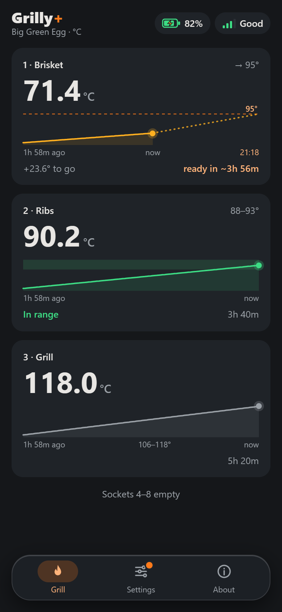
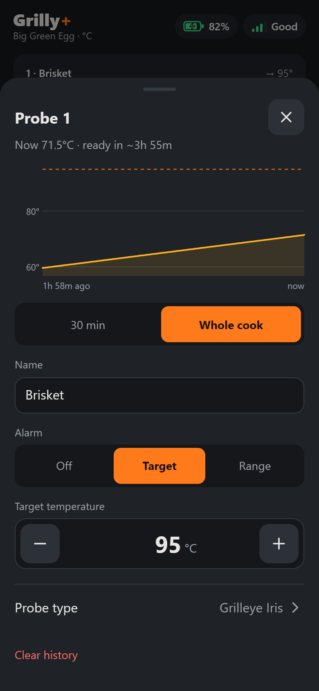
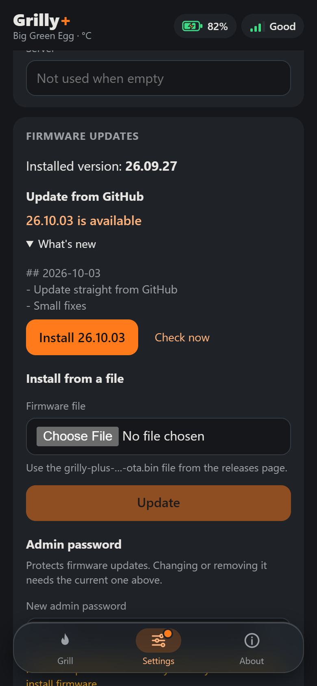
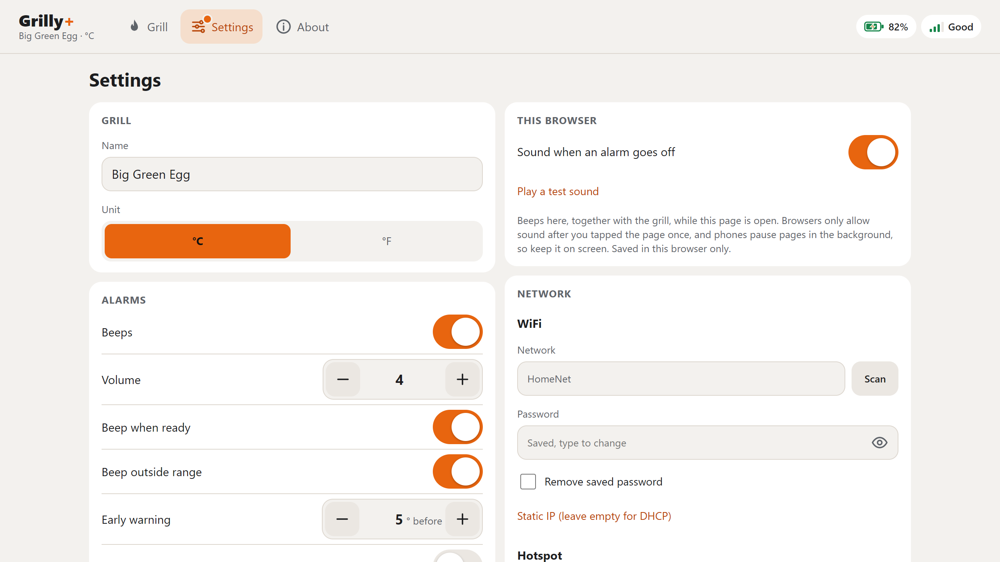
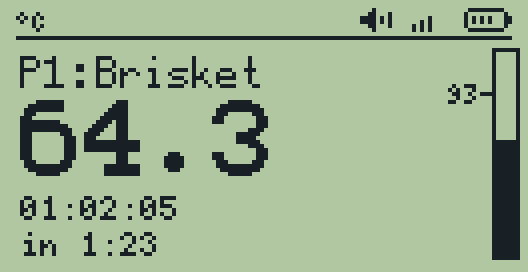
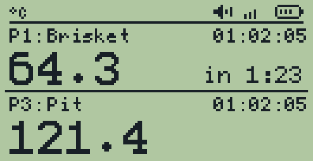
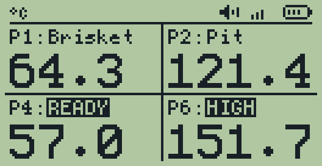
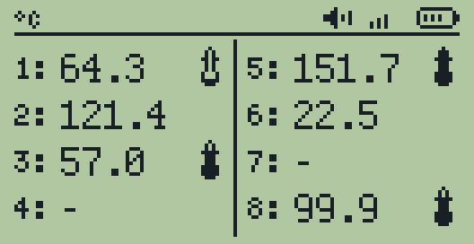
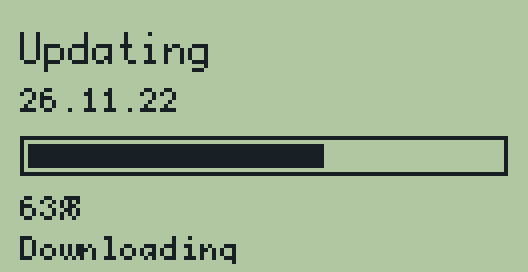
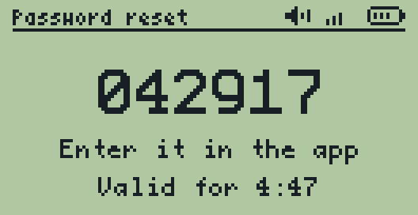

<h1 align="center">Grilly+</h1>

<p align="center">
  <strong>New firmware for the Grilleye Max. Your thermometer, back in business and better than it left the factory.</strong>
</p>

<p align="center">
  <a href="https://github.com/bardesss/grilly-plus/releases/latest"></a>
  <a href="https://github.com/bardesss/grilly-plus/actions/workflows/checks.yml"></a>
  <a href="https://opensource.org/licenses/MIT"></a>
</p>

The Grilleye Max is a great 8-probe thermometer whose maker stopped supporting it. Grilly+ gives it a second life: a fast web app on your phone, live graphs of every cook, a "ready in 1h 20m" estimate, alarms you can mute from the couch, and updates that install themselves from GitHub. No cloud, no account, no app store. Everything runs on the thermometer itself, on your own WiFi.

Grilly+ is a fork of [Free-Grilly](https://github.com/epiecs/free-grilly) by [Epiecs](https://github.com/epiecs) and [Questum](https://questum.be/), who reverse engineered the hardware and wrote the original firmware.

> [!WARNING]
> Grilly+ is unofficial firmware, not made or endorsed by GrillEye® / G&C. Flashing it is at your own risk and voids any remaining warranty. Read the [full disclaimer](#disclaimer) first.

---

## Why Grilly+

| | |
|---|---|
| 📱 **A real app, in your browser** | One card per probe with a live graph of the whole cook. Tap a card to set a name, a target temperature or a range. Works on any phone or computer, in dark or light mode. Nothing to install. |
| ⏱️ **Know when it's done** | Grilly+ watches how fast each probe heats up and tells you when it'll reach its target: "ready in ~1h 20m" in the app, "in 1:20" on the grill's own screen. |
| 🔔 **Alarms that make sense** | It beeps when food is ready or the grill leaves its range. Mute it from your phone, and the app shows which probe went off. The probe's label blinks on the grill too. |
| 🔄 **Updates with one tap** | The grill checks GitHub for new releases once a day. Tap **Install**, and a minute later it runs the new version. Every download is checksum-verified, and a failed update leaves the old version running. |
| 🏠 **Plays well with your smart home** | MQTT for Home Assistant and friends, plus a documented local REST API. |
| 🔒 **Yours, and only yours** | No cloud. An admin password protects updates, the hotspot gets its own password, and a forgotten admin password can be reset with a code from the grill's screen. |

## See it in action

**The web app** shows every probe at a glance. Tap one for the big chart and its settings.

<p align="center">
  
  
  
</p>




**On the grill itself**, the screen adapts to how many probes you use:

<table>
  <tr>
    <td align="center"><br><sub>One probe: big reading, target bar and time to target</sub></td>
    <td align="center"><br><sub>Two probes, with cook time and time to target</sub></td>
  </tr>
  <tr>
    <td align="center"><br><sub>Up to four probes, with READY / HIGH / LOW</sub></td>
    <td align="center"><br><sub>Five to eight probes, with a thermometer per target</sub></td>
  </tr>
  <tr>
    <td align="center"><br><sub>Installing an update from GitHub</sub></td>
    <td align="center"><br><sub>The code for resetting a forgotten admin password</sub></td>
  </tr>
</table>

---

## Contents

- [Features](#features)
- [Getting started](#getting-started)
- [Using the grill](#using-the-grill)
- [Updating the firmware](#updating-the-firmware)
- [Admin password](#admin-password)
- [Supported probes](#supported-probes)
- [Integrations: API, MQTT, Home Assistant](#integrations)
- [Development](#development)
- [Contributing](#contributing)
- [Built with AI](#built-with-ai)
- [Disclaimer](#disclaimer)

## Features

### On the grill
- **Temperature screens** for 1, 2, up to 4, and up to 8 probes, with the time to target, a target bar, and READY / HIGH / LOW labels. Long probe names are shortened to fit.
- **Alarms** when a probe reaches its target or leaves its range, following the "Beep when ready" and "Beep outside target" settings. The label of the probe that's beeping blinks. A muted alarm stays muted when you rename a probe or change a setting.
- **Info screen** with the grill's name, firmware, address, WiFi, and the hotspot's name and password.
- **Low-battery protection:** at 5 % or 3.2 V (not charging, confirmed for 15 seconds) the grill beeps three times and switches itself off cleanly, before an empty battery causes brownouts.
- **Reliable:** it starts back up by itself after an update, a crash or a factory reset. Empty probe sockets don't flicker, and the button is debounced so electrical noise can't fake a press.

### In the web app
- **Dashboard** with a card per connected probe: temperature, a graph of the whole cook, the target line or range band, and "ready in ~1h 20m".
- **Food presets:** pick steak medium-rare, pulled pork, chicken breast or one of about 20 other foods, and the target fills in. Safe temperatures follow the USDA.
- **Probe editor:** name, alarm (off / target / range) with large steppers, probe type, calibration offset, and a large chart with temperature labels, a "30 min / Whole cook" switch and **Clear history**.
- **Temperature history** on the grill: the last 30 minutes at 10 seconds per reading plus the whole cook at a coarser step, in a fixed ~5 KB, so even a 24-hour cook fits. It's kept until a restart, until a probe has been unplugged for more than 10 minutes, or until you clear it.
- **Time to target**, worked out from the last 10 minutes of readings in target mode. After a sudden drop, such as opening the lid, it picks up again after about 3 minutes of climbing.
- **Mute** a sounding alarm from your phone. The card of the probe that triggered it is highlighted.
- **Settings save themselves.** Network changes are applied together with one button, and every password field has a show/hide button.
- **About page** with the battery voltage and why the grill last restarted or switched off (crash, watchdog, update, button, factory reset, empty battery).
- Works on phones and desktops, in a dark or light theme that follows your device.

### Updates and security
- **Update from GitHub** with one tap, or **install from a file**. See [Updating the firmware](#updating-the-firmware).
- **Admin password** to protect firmware updates, with a reset code on the grill's screen if you forget it.
- **Generated hotspot password** on new and factory-reset grills, shown on the Info screen, so the grill's own WiFi isn't open to anyone in range. Grills upgraded from an older version keep the hotspot password they had.
- Passwords are never sent back by the API, and web pages on other sites can't change your settings or push firmware.

### Connectivity
- **Two ways in:** the grill's own hotspot (`http://192.168.200.10`) and your home WiFi.
- **Find it by name:** `http://grilly-plus-xxxxxxxx.local`, on both networks. The exact name is on the Info screen and the About page. (Some Android browsers don't resolve `.local` names; the IP address always works.)
- **Static IP or DHCP.** A static IP that's missing a gateway falls back to DHCP instead of making the grill unreachable.
- **MQTT** and a **local REST API**. See [Integrations](#integrations).
- **Opengrill (experimental):** support for the upcoming Opengrill server by [Epiecs](https://github.com/epiecs). It isn't public yet, so leave the Opengrill setting empty.

## Getting started

### 1. Install Grilly+

Follow the [flashing guide](docs/how_to_flash.md). You can flash from your browser over USB, no tools needed.

**Coming from Free-Grilly?** Install Grilly+ through Free-Grilly's own `/update` page with the `-ota.bin` file from the [latest release](https://github.com/bardesss/grilly-plus/releases/latest). Grilly+ uses the same settings storage, so your WiFi, probe and MQTT settings stay, including your MQTT topic prefix. Only fresh installs and factory resets get the new defaults (`Grilly+` as name, `grilly-plus` as MQTT prefix, `GrillyPlus_xxxxxx` as hotspot name).

### 2. Connect it to your WiFi

1. **Switch it on:** hold the side button until you hear the beeps, then let go.
2. **Find its hotspot:** the grill starts its own WiFi network, `GrillyPlus_xxxxxx`. Hold the button for 2 seconds (2 beeps) to see its name and password on the Info screen.
3. **Connect** your phone or computer to that network.
4. **Open** `http://192.168.200.10` in a browser.
5. **Enter your home WiFi** under **Settings**, then **Network**, and tap **Apply**.
6. **Done.** The grill joins your WiFi and gets an address from your router. Reach it at `http://grilly-plus-xxxxxxxx.local` or its IP address, both shown on the Info screen. The hotspot keeps working too.

The [WiFi guide](docs/how_to_connect_to_wifi.md) walks through it with screenshots.

## Using the grill

### The button

| Press | What it does |
|---|---|
| Hold ~2 s while off (2 beeps) | Switch on |
| Short press | Next screen; mutes a sounding alarm; takes a password reset code off the screen |
| Hold 2 s (2 beeps) | Info screen with WiFi and hotspot details |
| Hold 3 s (3 beeps) | Switch off |
| Hold 10 s (3 long beeps) | Factory reset: clears **all** settings |

### Probes and alarms

Tap a probe card in the app to set it up:
- **Off:** just show the temperature.
- **Target:** beep when the probe reaches the target (and optionally a few degrees before). This mode also shows the time to target.
- **Range:** beep when the temperature leaves the min-max range. Ideal for the grill or smoker temperature.

Not sure what temperature to use? Pick a food under **Food** and the target fills in. A probe that still has its default name ("Probe 3") gets the food's name.

**Calibration offset** (-10 to 10 °C) corrects a probe that reads a little high or low. It belongs to the socket, not the probe, so keep the probe in the same socket.

## Updating the firmware

### From GitHub (recommended)

1. Open the web app and go to **Settings**, then **Firmware updates**. When a new release is out, it says "*version* is available" and the Settings tab shows a dot. **What's new** shows the release notes; **Check now** checks right away instead of waiting for the daily check.
2. If you set an admin password, enter it under **Current admin password**.
3. Tap **Install** and confirm. Keep the grill on the charger or above 30 % battery.
4. The grill restarts into update mode: the screen dims and shows a progress bar. After about a minute it restarts into the new version and the page reloads. If anything goes wrong, it keeps the old version and the app tells you why.

The grill only downloads from this repository's releases, and only installs a file whose size and SHA-256 checksum match what GitHub lists. An interrupted update is safe: the new firmware is written next to the running one and only takes over after a complete, verified write.

**First time:** updating from GitHub arrived in release 26.11.22. On an older version, install 26.11.22 or newer from a file once; after that, every update can come from GitHub.

### From a file

1. Download the latest `grilly-plus-yyyy-mm-dd-ota.bin` from [Releases](https://github.com/bardesss/grilly-plus/releases/latest).
2. In the web app, go to **Settings**, then **Firmware updates**.
3. Under **Install from a file**, choose the `-ota.bin` file and press **Update**. If you set an admin password, enter it under **Current admin password** first.
4. The grill installs it, restarts on its own, and the page reloads.

## Admin password

Set an admin password at the bottom of **Settings**, then **Firmware updates**, so only you can install firmware, from GitHub or from a file. Once it's set, changing or removing it needs the current one (the app asks for it; the API takes it as Basic auth with user `admin`). It can't be changed over MQTT.

### Forgot the admin password?

Reset it from the app, as long as you can see the grill's screen. All your other settings (WiFi, probes, alarms, calibration) stay as they are.

1. In the web app, go to **Settings**, then **Firmware updates**.
2. Under **Current admin password**, tap **Forgot the admin password?**
3. The grill beeps once and its screen shows a 6-digit code, valid for 5 minutes.
4. Type the code in the app. Enter a new admin password, or leave it empty to remove the password.
5. Tap **Reset password**. The new password works right away.

A code works once. After 5 wrong tries it ends, and you can ask for a new one a minute later. After 15 wrong tries in total, the grill stops giving out codes until you restart it. **Cancel** in the app takes the code off the grill's screen, and so does a short press on the button (handy for a code you didn't ask for). If all else fails, a factory reset (hold the button for 10 seconds) clears the admin password, together with all other settings.

## Supported probes

The Grilleye Iris probes that came with the grill work best, but Grilly+ supports more:

| Probe type     | ref °C | ref kΩ | ref beta | Notes                                         |
|----------------|--------|--------|----------|-----------------------------------------------|
| Grilleye Iris  | 25     | 100    | 4250     | The best probe you can use: fast and accurate |
| Ikea Fantast   | 25     | 230    | 4250     | Slow; not for quick measurements              |
| Maverick ET733 | 25     | 200    | 4250     |                                               |
| Weber iGrill   | 25     | 100    | 3830     |                                               |

Any other **NTC** probe works as a `custom` probe if you know its reference temperature (°C), reference resistance (kΩ) and beta value. The [probe calculator spreadsheet](docs/probe_calculator.xlsx) helps you work them out.

## Integrations

### REST API

The grill has a local JSON API, documented in [openapi.yaml](docs/openapi.yaml) ([view it online](https://editor-next.swagger.io/?url=https://raw.githubusercontent.com/bardesss/grilly-plus/refs/heads/master/docs/openapi.yaml)). Some highlights:

- `GET /api/grill` and `GET /api/probes`: live status and probe readings, with `eta_seconds` per probe; `/api/grill` also has `update_available`.
- `GET /api/info`: which firmware runs and which features (`capabilities`) it has, for apps and integrations.
- `GET /api/history` and `POST /api/history/clear`: the temperature history.
- `GET /api/update/latest`, `POST /api/update/check` and `POST /api/update/install`: updating from GitHub.
- `POST /api/admin/reset/start`, `/api/admin/reset/cancel` and `/api/admin/reset`: resetting a forgotten admin password with the code from the screen.

### MQTT

Point the grill at your MQTT broker under **Settings** and it publishes the grill status, probes and settings. You can also change probes and settings over MQTT, including partial updates that only touch the keys you send, mute an alarm, and clear a probe's history. Topics and payloads are in [docs/mqtt.md](docs/mqtt.md).

### Home Assistant

Grilly+ works with Home Assistant through MQTT; for now you create the entities yourself. The example below, based on a starting point by [@woutercoppens](https://github.com/woutercoppens) (see [Free-Grilly issue #5](https://github.com/epiecs/free-grilly/issues/5)), adds a temperature and target sensor for all 8 probes plus the battery. Replace the device id in `state_topic` with your grill's (shown under the MQTT topic in the settings). If you upgraded from Free-Grilly, your topic prefix is still `free-grilly` unless you changed it.

<details>
<summary>Home Assistant MQTT sensors (YAML)</summary>

```yaml
# Probe 1 (Defines Anchors)
- name: "Grilly+ Probe 1 Temperature"
  unique_id: "grilly_plus_probe_1_temp"
  <<: &probe_temp_defaults
    state_topic: "grilly-plus/7107d787-30c7-4d20-9b1b-db4cfd14fca4/grill" #Adjust
    unit_of_measurement: "°C"
    device_class: temperature
    state_class: measurement
    payload_available: "online"
    payload_not_available: "offline"
    device: &device_info
      identifiers: "grilly_plus_7107d787" #Adjust
      name: "Grilly+ Thermometer"
      manufacturer: "Grilly+"
      sw_version: "25.08.27"
  value_template: "{{ value_json.probes[0].temperature }}"
  availability_template: "{{ 'online' if value_json.probes[0].connected == true else 'offline' }}"

- name: "Grilly+ Probe 1 Target"
  unique_id: "grilly_plus_probe_1_target"
  <<: &probe_target_defaults
    state_topic: "grilly-plus/7107d787-30c7-4d20-9b1b-db4cfd14fca4/grill" #Adjust
    unit_of_measurement: "°C"
    device_class: temperature
    icon: mdi:target
    payload_available: "online"
    payload_not_available: "offline"
    device: *device_info
  value_template: "{{ value_json.probes[0].target_temperature }}"
  availability_template: "{{ 'online' if value_json.probes[0].connected == true else 'offline' }}"

# Probe 2
- name: "Grilly+ Probe 2 Temperature"
  unique_id: "grilly_plus_probe_2_temp"
  <<: *probe_temp_defaults
  value_template: "{{ value_json.probes[1].temperature }}"
  availability_template: "{{ 'online' if value_json.probes[1].connected == true else 'offline' }}"
- name: "Grilly+ Probe 2 Target"
  unique_id: "grilly_plus_probe_2_target"
  <<: *probe_target_defaults
  value_template: "{{ value_json.probes[1].target_temperature }}"
  availability_template: "{{ 'online' if value_json.probes[1].connected == true else 'offline' }}"

# Probe 3
- name: "Grilly+ Probe 3 Temperature"
  unique_id: "grilly_plus_probe_3_temp"
  <<: *probe_temp_defaults
  value_template: "{{ value_json.probes[2].temperature }}"
  availability_template: "{{ 'online' if value_json.probes[2].connected == true else 'offline' }}"
- name: "Grilly+ Probe 3 Target"
  unique_id: "grilly_plus_probe_3_target"
  <<: *probe_target_defaults
  value_template: "{{ value_json.probes[2].target_temperature }}"
  availability_template: "{{ 'online' if value_json.probes[2].connected == true else 'offline' }}"

# Probe 4
- name: "Grilly+ Probe 4 Temperature"
  unique_id: "grilly_plus_probe_4_temp"
  <<: *probe_temp_defaults
  value_template: "{{ value_json.probes[3].temperature }}"
  availability_template: "{{ 'online' if value_json.probes[3].connected == true else 'offline' }}"
- name: "Grilly+ Probe 4 Target"
  unique_id: "grilly_plus_probe_4_target"
  <<: *probe_target_defaults
  value_template: "{{ value_json.probes[3].target_temperature }}"
  availability_template: "{{ 'online' if value_json.probes[3].connected == true else 'offline' }}"

# Probe 5
- name: "Grilly+ Probe 5 Temperature"
  unique_id: "grilly_plus_probe_5_temp"
  <<: *probe_temp_defaults
  value_template: "{{ value_json.probes[4].temperature }}"
  availability_template: "{{ 'online' if value_json.probes[4].connected == true else 'offline' }}"
- name: "Grilly+ Probe 5 Target"
  unique_id: "grilly_plus_probe_5_target"
  <<: *probe_target_defaults
  value_template: "{{ value_json.probes[4].target_temperature }}"
  availability_template: "{{ 'online' if value_json.probes[4].connected == true else 'offline' }}"

# Probe 6
- name: "Grilly+ Probe 6 Temperature"
  unique_id: "grilly_plus_probe_6_temp"
  <<: *probe_temp_defaults
  value_template: "{{ value_json.probes[5].temperature }}"
  availability_template: "{{ 'online' if value_json.probes[5].connected == true else 'offline' }}"
- name: "Grilly+ Probe 6 Target"
  unique_id: "grilly_plus_probe_6_target"
  <<: *probe_target_defaults
  value_template: "{{ value_json.probes[5].target_temperature }}"
  availability_template: "{{ 'online' if value_json.probes[5].connected == true else 'offline' }}"

# Probe 7
- name: "Grilly+ Probe 7 Temperature"
  unique_id: "grilly_plus_probe_7_temp"
  <<: *probe_temp_defaults
  value_template: "{{ value_json.probes[6].temperature }}"
  availability_template: "{{ 'online' if value_json.probes[6].connected == true else 'offline' }}"
- name: "Grilly+ Probe 7 Target"
  unique_id: "grilly_plus_probe_7_target"
  <<: *probe_target_defaults
  value_template: "{{ value_json.probes[6].target_temperature }}"
  availability_template: "{{ 'online' if value_json.probes[6].connected == true else 'offline' }}"

# Probe 8
- name: "Grilly+ Probe 8 Temperature"
  unique_id: "grilly_plus_probe_8_temp"
  <<: *probe_temp_defaults
  value_template: "{{ value_json.probes[7].temperature }}"
  availability_template: "{{ 'online' if value_json.probes[7].connected == true else 'offline' }}"
- name: "Grilly+ Probe 8 Target"
  unique_id: "grilly_plus_probe_8_target"
  <<: *probe_target_defaults
  value_template: "{{ value_json.probes[7].target_temperature }}"
  availability_template: "{{ 'online' if value_json.probes[7].connected == true else 'offline' }}"

# Battery
- name: "Grilly+ Battery"
  unique_id: "grilly_plus_battery"
  state_topic: "grilly-plus/7107d787-30c7-4d20-9b1b-db4cfd14fca4/grill" #Adjust
  unit_of_measurement: "%"
  device_class: battery
  state_class: measurement
  payload_available: "online"
  payload_not_available: "offline"
  availability_template: "{{ 'online' if value_json.wifi_connected else 'offline' }}"
  value_template: "{{ value_json.battery_percentage }}"
  device: *device_info
```

</details>

### Opengrill (experimental)

The Opengrill server isn't public yet. Once it is, enter its address in the Opengrill field in the settings. While the field is empty, Grilly+ doesn't try to reach an Opengrill server.

## Development

The web app lives in `web/`: plain HTML, CSS and JavaScript, with no build step while you work on it.

1. Edit the files in `web/`.
2. Run `python tools/dev_server.py --mock` for mock data, or `python tools/dev_server.py <grill-ip>` to use a real grill.
3. Open http://localhost:8000 and reload after each change.

`pio run` builds the web app into the firmware automatically.

Tests (they also run in CI on every pull request):

```
node --test "web/tests/*.test.js"
python -m unittest discover -s tools -p "test_*.py"
pio test -e native     # firmware logic (history, time to target, low battery, updates, password reset); needs a host C++ compiler
```

Building your own Grilly+ hardware? [docs/diy_hardware.md](docs/diy_hardware.md) is a work-in-progress design for a DIY unit.

## Contributing

Ideas, bug reports and pull requests are welcome.

- **Found a bug or have an idea?** Check the [Issues](https://github.com/bardesss/grilly-plus/issues) first, and open a new one with as much detail as you can if it isn't there yet.
- **Want to change something?** Fork the repository, make your change on a branch, and open a [pull request](https://github.com/bardesss/grilly-plus/pulls) against `master`. The checks must pass before it can be merged.

The detailed history of every release is in [changelog.md](changelog.md). Fixes that are useful for everyone are offered back to [Free-Grilly](https://github.com/epiecs/free-grilly) where possible.

## Built with AI

Grilly+ is developed with the help of AI coding agents (Anthropic's Claude). Every change goes through a pull request with automated tests and a code review, and firmware changes are tested on a real Grilleye Max before they're merged. Still, read the changes yourself if you rely on them, and report anything that looks wrong in the [Issues](https://github.com/bardesss/grilly-plus/issues).

## Disclaimer

- This firmware is unofficial and **not** affiliated with or endorsed by the original manufacturer (GrillEye® by G&C).
- Flashing custom firmware carries risks. You could damage or "brick" your Grilleye Max.
- You proceed entirely **at your own risk**. The authors and contributors are not responsible for any damage to your device.
- Flashing custom firmware voids any remaining manufacturer warranty.

Grilly+ is released under the [MIT License](https://opensource.org/licenses/MIT).
