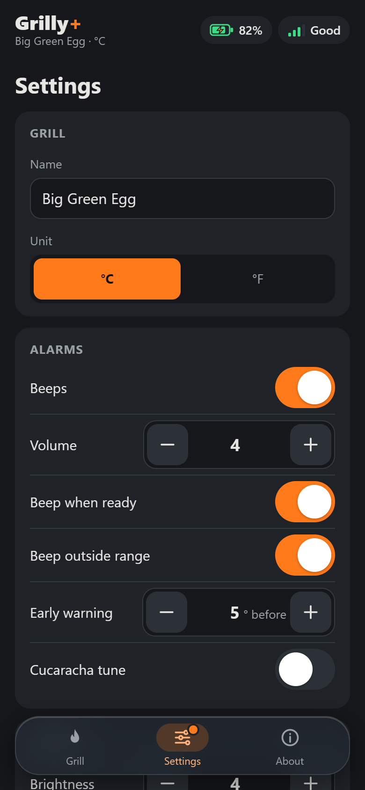
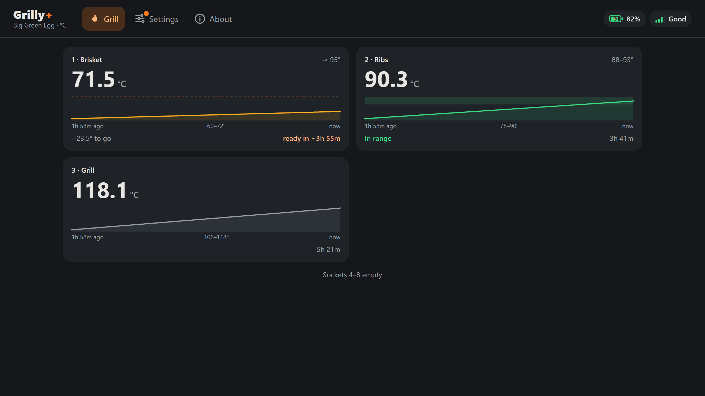
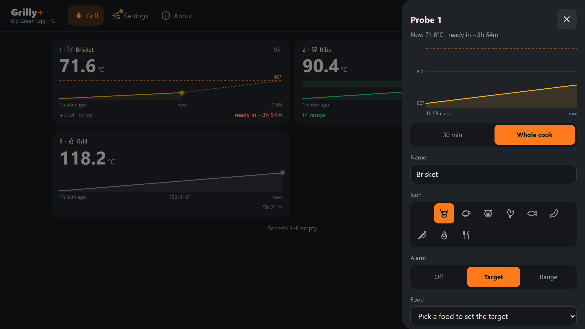

# Grilly+: Community Firmware for Grilleye Max

[](https://opensource.org/licenses/MIT) 

**Reviving your Grilleye Max thermometer with this community-driven firmware!**

This project provides alternative firmware for the Grilleye Max thermometer. After the original manufacturer discontinued software support, this firmware was developed through reverse engineering to keep these capable devices functional.

Grilly+ is a fork of [Free-Grilly](https://github.com/epiecs/free-grilly) by [Epiecs](https://github.com/epiecs) and [Questum](https://questum.be/), who did the reverse engineering and wrote the original firmware. This fork adds my own improvements on top. Fixes that are useful for everyone will be offered back upstream where possible.

**Upgrading from Free-Grilly:** Grilly+ keeps using the same settings storage (the NVS namespace is unchanged), so an OTA upgrade keeps your WiFi, probe and MQTT settings, including your existing MQTT topic prefix. Only fresh installs and factory resets use the new defaults (`Grilly+` as name, `grilly-plus` as MQTT prefix, `GrillyPlus_xxxxxx` as AP name). Since your device is still running Free-Grilly the first time, flash it the normal way, through Free-Grilly's own `/update` page.

---

## What's new in Grilly+

Grilly+ is the same firmware Free-Grilly users already know, with a new web app and a round of reliability fixes on top:

* **New web app.** A dashboard with a card per connected probe; tap one to set its name, target temperature or range with steppers. Settings save themselves, and it works just as well on a phone as on a desktop, in dark or light theme depending on the device.
* **Firmware updates moved into the app.** They now happen from the Settings view instead of the old ElegantOTA `/update` page, and can be protected with an admin password.
* **A generated hotspot password** on new or factory-reset devices, shown on the device's Info screen, so the local access point isn't open to anyone in range by default.
* **Tighter security around settings and updates:** passwords are never returned by the API, and cross-site pages can no longer change your settings or push a firmware update.
* **A round of reliability fixes:** the grill boots back up on its own after an update, a crash or a factory reset; a saved static IP that's missing a gateway now falls back to DHCP instead of going unreachable; empty probe sockets no longer flicker; and muted alarms stay muted when you save a probe.
* **Reach it by name:** `http://grilly-plus-xxxxxxxx.local` instead of looking up an IP address.
* **Mute from your phone:** a sounding alarm can be muted from the web app or over MQTT, and the card of the probe that triggered it is highlighted.
* **Calibration offset** per probe, for probes that read a little high or low.
* **Diagnostics:** the About page shows why the grill last restarted or switched off, and the battery voltage.
* **Temperature graphs:** every probe card shows a graph of the whole cook, and the probe editor has a large chart with a "30 min / Whole cook" switch and a Clear history button.
* **Time to target:** "ready in ~1h 20m" on the card, in the editor, on the grill's own screen and over MQTT, worked out from how fast the probe has been heating up.
* **Blinking alarm label** on the grill's screen, so you can see which probe is beeping.
* **Low-battery protection:** the grill switches itself off cleanly before an empty battery causes brownouts.
* **Update from GitHub:** the grill finds new Grilly+ releases by itself; one tap on **Install** in the app downloads and installs it, no file juggling.
* **Forgot the admin password?** Reset it with a code from the grill's own screen, without a factory reset.

See the [Features](#features) list below for the full picture, and [changelog.md](changelog.md) for the detailed history.

---


---

**🤖 Built with AI**

Grilly+ is developed with the help of AI coding agents (Anthropic's Claude). Every change goes through a pull request with automated tests and a code review, and firmware changes are tested on a real Grilleye Max before they're merged. Still, read the changes yourself if you rely on them, and report anything that looks wrong in the [Issues](https://github.com/bardesss/grilly-plus/issues).

**⚠️ IMPORTANT DISCLAIMER ⚠️**

* This firmware is unofficial and NOT affiliated with or endorsed by the original manufacturer (GrillEye® by G&C).
* Flashing custom firmware onto your device carries risks. You could potentially damage or "brick" your Grilleye Max.
* You proceed entirely **at your own risk**. The authors and contributors are not responsible for any damage to your device.
* Flashing custom firmware will void any remaining manufacturer warranty.

---

- [Grilly+: Community Firmware for Grilleye Max](#grilly-community-firmware-for-grilleye-max)
  - [What's new in Grilly+](#whats-new-in-grilly)
  - [Features](#features)
  - [Web interface](#web-interface)
  - [API documentation](#api-documentation)
  - [Installation](#installation)
  - [First Use \& WiFi Setup](#first-use--wifi-setup)
  - [Usage](#usage)
    - [Button](#button)
  - [Updating Firmware (OTA)](#updating-firmware-ota)
  - [Supported probes](#supported-probes)
  - [Connecting to Opengrill (experimental)](#connecting-to-opengrill-experimental)
  - [Home assistant support](#home-assistant-support)
  - [Development](#development)
  - [Contributing](#contributing)

## Features

* **On-Device Temperature Display:** Shows current probe temperatures directly on the Grilleye Max screen. The probe screen shows the time to target, and the label of a probe whose alarm is sounding blinks.
* **Audible Alerts:** The device beeps to notify you when temperatures go outside a set range or when food is nearing its target temperature, following the "Beep when ready" and "Beep outside target" settings, and it won't replay an alarm you already muted just because you renamed a probe or saved a setting. A sounding alarm can also be muted from the web app or over MQTT, not just the device's button, and the web app highlights the specific probe card(s) that triggered it.
* **New web app:** a dashboard with a card per connected probe. Tap one to set its name, target temperature or a min/max range, with large steppers for quick adjustments. Settings save themselves, network changes are applied together with one button, password fields have a show/hide button, and the app works equally well on a phone or a desktop, in a dark or light theme that follows the device.
* **Dual Web Access:** Access the web interface via:
    * A local Access Point (AP) mode (`http://192.168.200.10`) for initial setup.
    * Your home WiFi network (once configured) using the device's local IP address. The About page shows both addresses.
* **mDNS discovery:** the grill is also reachable at `http://grilly-plus-xxxxxxxx.local`, no IP lookup needed, both on your home WiFi and on its own hotspot. The exact address is shown on the device's Info screen and the web app's About page. Some Android versions don't resolve `.local` names in the browser; the IP address still works there.
* **Temperature graphs:** each probe card shows a graph of the whole cook with the target line or range band, the time span and the temperature range. Tap a card for a large chart with temperature labels, a "30 min / Whole cook" switch and a Clear history button (two taps). The grill keeps the last 30 minutes at 10 seconds per reading plus the whole cook at a coarser step, in a fixed ~5 KB of memory, so even a 24-hour cook fits. The history is kept until a restart, a probe is unplugged for more than 10 minutes, or you clear it.
* **Time to target:** in target mode the grill works out when the probe will be ready from the last 10 minutes of readings, and shows it as "ready in ~1h 20m" on the card and in the editor, as "in 1:20" on the device's probe screen, and as `eta_seconds` in the API and MQTT. It restarts quickly after a drop, for example when you open the lid.
* **Diagnostics on the About page:** battery voltage plus why the grill last restarted or was switched off (crash, watchdog, update, button, factory reset, ...), so an unexpected power-off no longer needs guesswork.
* **Generated hotspot password:** new and factory-reset devices get a random hotspot password, shown on the device's Info screen, instead of an open access point. Devices upgraded from an earlier version keep whatever hotspot password (or lack of one) they already had.
* **Probe Flexibility:**
    * **Custom Probe Configuration:** Manually configure support for various NTC thermistor probes by entering their specific resistance (kΩ at reference temperature), reference temperature (°C), and Beta coefficient value.
    * **Pre-configured Probes:** Includes ready-to-use settings for popular probes like the Ikea Fantast.
    * **Calibration offset:** Fine-tune a probe that reads a little high or low with a per-probe offset (-10..10 °C), applied to every reading before it's shown, alarmed on or sent out.
    * Empty probe sockets no longer flicker between connected and disconnected.
* **Update from GitHub:** the grill checks the Grilly+ releases on GitHub once a day (and when you tap **Check now**), and the app shows a dot on the Settings tab when a newer version is out. Tap **Install** and the grill restarts into a lean update mode with a dimmed screen and a progress bar, downloads the release over HTTPS, checks its size and SHA-256 checksum, and restarts into the new version after about a minute. If anything goes wrong (no WiFi, a cut-off download, a wrong checksum) it keeps the old version and the app tells you why. It only starts with at least 30 % battery or on the charger, and it needs the admin password when one is set.
* **Firmware updates from a file:** install a new `-ota.bin` from the Settings view. An optional admin password can protect updates; changing or removing it requires the current one, and it can't be changed over MQTT. A forgotten password can be reset with a code that the grill shows on its screen (see [Forgot the admin password?](#forgot-the-admin-password)).
* **Local REST API:** Provides a RESTful API endpoint on the device for integration with custom scripts, home automation systems, or other applications. Passwords are never returned by the API, and cross-site pages can't change your settings or push a firmware update.
* **MQTT support:** All data (grill status/probes/settings/`connected_seconds`) is sent to an mqtt topic. You can also configure probes and settings via mqtt, including partial updates that only change the keys you send.
  * [Mqtt documentation](docs/mqtt.md)
* **Battery Management:** Includes functional battery monitoring and management based on the device's hardware. A failed fuel-gauge reading is detected and ignored instead of showing up as 65535 %. When the battery is empty (5 % or 3.2 V, not charging, confirmed for 15 seconds) the grill beeps three times and switches itself off cleanly; About then shows "Battery empty" as the reason.
* **Button Functionality:** The side button works for powering the device on/off and performing a factory reset (via long 10 seconds press). It's debounced, so electrical noise can't cut a long press short or fake a press.
* **Persistent Settings:** All your configuration settings are saved directly on the device's non-volatile memory.
* **Reliability:** the grill boots straight back up after a firmware update, a factory reset, or an unexpected crash, instead of needing the button held; a saved static IP with a missing gateway falls back to DHCP instead of leaving the device unreachable. The early warning beep no longer pauses probe readings, and data shared between the firmware's tasks is locked so it can't be read while it's being changed.
* **Opengrill (experimental):** Support for the upcoming Opengrill server by [epiecs](https://github.com/epiecs). The server is not public yet, so leave the Opengrill setting empty.

## Web interface

Open the grill's address in a browser on your phone or computer. The dashboard shows every connected probe with a graph of the cook; tap one for a large chart and to set its name, a target temperature or a range. Settings save themselves.

<p>
  
  
  
</p>






## API documentation

- Api documentation is include in the [openapi.yaml file](docs/openapi.yaml)
- You can also view this [online](https://editor-next.swagger.io/?url=https://raw.githubusercontent.com/bardesss/grilly-plus/refs/heads/master/docs/openapi.yaml)
- `GET /api/info` tells an app or integration which firmware runs and which Grilly+ features (`capabilities`) it has.
- `GET /api/history` returns the temperature history of the connected probes, `POST /api/history/clear` clears one.
- `POST /api/admin/reset/start` shows a code on the grill's screen, `POST /api/admin/reset` with that code sets a new admin password.
- `GET /api/update/latest`, `POST /api/update/check` and `POST /api/update/install` check GitHub for a newer release and install it; `/api/grill` and MQTT carry `update_available`.

## Installation

For installation please refer to the [Flashing guide](docs/how_to_flash.md)

## First Use & WiFi Setup

1.  **Power On:** Turn on your Grilleye Max by pressing the side button. Once you hear the beeps you can release the button.
2.  **AP Mode:** The device will initially boot into Access Point (AP) mode. It will create its own WiFi network. *(GrillyPlus_xxxxxx)*
3.  If you can not see this network you can hold the side button for 2 seconds until you hear 2 beeps and then release the button. The screen will now show you the name of the wifi ap on your grilly-plus
4.  **Connect to AP:** Using your phone or computer, connect to this new WiFi network.
5.  **Access Web Interface:** Open a web browser and navigate to `http://192.168.200.10`.
6.  **Configure WiFi:** Find the "Settings" or "WiFi Configuration" page in the web interface. Select your home WiFi network (SSID), enter the password, and save.
7.  **Reconnect:** The Grilleye Max should now connect to your own WiFi network. Its IP address will now be assigned by your router  (The local ap will keep on working as well). You can also reach it at `http://grilly-plus-xxxxxxxx.local` instead of looking up the IP; the exact address is on the device's Info screen and the web app's About page.

## Usage

- **Temperatures:** Temperature readings from connected probes are displayed on the device's screen and updated in the web interface.
- **Web Interface:** Access the web interface using the IP address assigned by your router to view temperatures, change settings, etc.
- **Probe Settings:** Within the web interface settings, you can:
    - Set minimum and target temperature alerts for each probe.
    - Configure the type of probe connected (e.g., adjust settings to work with Ikea Fantast probes).

### Button

- Hold the button for 2 seconds to boot the device. You will hear 2 beeps
- If the device is booted hold the button for 2 seconds until you hear 2 beeps and then release the button to view a status screen with wifi details etc
- Tap the button to return to the temperature view
- Hold the button for 3 seconds until you hear 3 beeps to turn the device off
- Hold the button for 10 seconds until you hear 3 long beeps to factory reset

## Updating Firmware (OTA)

### From GitHub (recommended)

  1. Open the web interface and go to **Settings**, then **Firmware updates**. When a newer release is out it says "*version* is available" (the Settings tab shows a dot); **What's new** shows the release notes, and **Check now** checks right away instead of waiting for the daily check.
  2. If you set an admin password, enter it under **Current admin password**.
  3. Tap **Install** and confirm. Keep the grill on the charger or above 30 % battery.
  4. The grill restarts into update mode: the screen dims and shows the version and a progress bar. After about a minute it restarts into the new version and the page reloads. If the update fails, the grill keeps running the old version and the app shows the reason.

The grill only downloads from this repository's releases, and only installs a file whose size and SHA-256 checksum match what GitHub lists for it. An interrupted update is safe: the new firmware is written next to the running one and only takes over after a complete, verified write.

**First time:** the GitHub update arrives in the first release that contains it, so install that one release from a file (below). Every release after it can come straight from GitHub.

### From a file

  1. Download the latest `grilly-plus-yyyy-mm-dd-ota.bin` from Releases.
  2. Open the web interface and go to **Settings**, then **Firmware updates**.
  3. Under **Install from a file**, choose the downloaded `-ota.bin` file and press **Update**. If you set an admin password, enter it under **Current admin password** first.
  4. Wait while it uploads and installs. The grill restarts on its own and the page reloads.

### Admin password

Set an admin password at the bottom of the same card so only you can install firmware, from GitHub or from a file. Once it is set, changing or removing it needs the current one (the web app asks for it, the API takes it as Basic auth with user `admin`). It can't be changed over MQTT.

### Forgot the admin password?

You can reset it from the web app, as long as you can see the grill's screen. All your other settings (WiFi, probes, alarms, calibration) stay as they are.

  1. Open the web interface and go to **Settings**, then **Firmware updates**.
  2. Under **Current admin password**, tap **Forgot the admin password?**
  3. The grill beeps once and its screen shows a 6-digit code, valid for 5 minutes.
  4. Type that code in the app. Enter a new admin password, or leave the field empty to remove the password.
  5. Tap **Reset password**. The new password works right away.

A code works once. After 5 wrong tries it ends and you can ask for a new one a minute later. After 15 wrong tries in total the grill stops giving out codes until you restart it. **Cancel** in the app takes the code off the grill's screen, and so does a short press on the grill's button (for example for a code you didn't ask for). If you can't get it to work, a factory reset (hold the button for 10 seconds) also clears the admin password, together with all other settings.

## Supported probes

Grilly+ supports more probes that the included Grilleye Iris probes. Support for the following probes is built-in:

| Probe type     | ref C | ref kOhm | ref beta | notes                                          |
|----------------|-------|----------|----------|------------------------------------------------|
| Grilleye Iris  | 25    | 100      | 4250     | The best probe you can use. Fast and accurate  |
| Ikea fantast   | 25    | 230      | 4250     | Slow. Do not use for quick measurements        |
| Maverick ET733 | 25    | 200      | 4250     |                                                |
| Weber Igrill   | 25    | 100      | 3830     |                                                |

Apart from that you can also add your own `custom` **NTC** probes if you know the 3 most important values
-   Reference temperature in Celcius
-   Reference beta value
-   Reference resistance in kOhm

If you want you can use our [handy calculator spreadsheet](docs/probe_calculator.xlsx) if you want to calculate the values for your own probes. 

## Connecting to Opengrill (experimental)

The Opengrill server is not publicly available yet. Once it is, enter its ip in the Opengrill field on the settings page. As long as the field is empty, Grilly+ does not try to reach an Opengrill server.

## Home assistant support
You can connect your Grilly+ to your current home assistant installation when using the mqtt broker. For this you will need to manually create the needed entities. [@woutercoppens](https://github.com/woutercoppens) provided us/you with a decent starting point. This can also be seen in [Free-Grilly issue #5](https://github.com/epiecs/free-grilly/issues/5).

The example uses the new default topic prefix `grilly-plus`. If you upgraded from Free-Grilly, your device keeps its old `free-grilly` prefix, so either use that in the `state_topic` lines or change the prefix in the settings.

```yaml
# Probe 1 (Defines Anchors)
- name: "Grilly+ Probe 1 Temperature"
  unique_id: "grilly_plus_probe_1_temp"
  <<: &probe_temp_defaults
    state_topic: "grilly-plus/7107d787-30c7-4d20-9b1b-db4cfd14fca4/grill" #Adjust
    unit_of_measurement: "°C"
    device_class: temperature
    state_class: measurement
    payload_available: "online"
    payload_not_available: "offline"
    device: &device_info
      identifiers: "grilly_plus_7107d787" #Adjust
      name: "Grilly+ Thermometer"
      manufacturer: "Grilly+"
      sw_version: "25.08.27"
  value_template: "{{ value_json.probes[0].temperature }}"
  availability_template: "{{ 'online' if value_json.probes[0].connected == true else 'offline' }}"

- name: "Grilly+ Probe 1 Target"
  unique_id: "grilly_plus_probe_1_target"
  <<: &probe_target_defaults
    state_topic: "grilly-plus/7107d787-30c7-4d20-9b1b-db4cfd14fca4/grill" #Adjust
    unit_of_measurement: "°C"
    device_class: temperature
    icon: mdi:target
    payload_available: "online"
    payload_not_available: "offline"
    device: *device_info
  value_template: "{{ value_json.probes[0].target_temperature }}"
  availability_template: "{{ 'online' if value_json.probes[0].connected == true else 'offline' }}"

# Probe 2
- name: "Grilly+ Probe 2 Temperature"
  unique_id: "grilly_plus_probe_2_temp"
  <<: *probe_temp_defaults
  value_template: "{{ value_json.probes[1].temperature }}"
  availability_template: "{{ 'online' if value_json.probes[1].connected == true else 'offline' }}"
- name: "Grilly+ Probe 2 Target"
  unique_id: "grilly_plus_probe_2_target"
  <<: *probe_target_defaults
  value_template: "{{ value_json.probes[1].target_temperature }}"
  availability_template: "{{ 'online' if value_json.probes[1].connected == true else 'offline' }}"

# Probe 3
- name: "Grilly+ Probe 3 Temperature"
  unique_id: "grilly_plus_probe_3_temp"
  <<: *probe_temp_defaults
  value_template: "{{ value_json.probes[2].temperature }}"
  availability_template: "{{ 'online' if value_json.probes[2].connected == true else 'offline' }}"
- name: "Grilly+ Probe 3 Target"
  unique_id: "grilly_plus_probe_3_target"
  <<: *probe_target_defaults
  value_template: "{{ value_json.probes[2].target_temperature }}"
  availability_template: "{{ 'online' if value_json.probes[2].connected == true else 'offline' }}"

# Probe 4
- name: "Grilly+ Probe 4 Temperature"
  unique_id: "grilly_plus_probe_4_temp"
  <<: *probe_temp_defaults
  value_template: "{{ value_json.probes[3].temperature }}"
  availability_template: "{{ 'online' if value_json.probes[3].connected == true else 'offline' }}"
- name: "Grilly+ Probe 4 Target"
  unique_id: "grilly_plus_probe_4_target"
  <<: *probe_target_defaults
  value_template: "{{ value_json.probes[3].target_temperature }}"
  availability_template: "{{ 'online' if value_json.probes[3].connected == true else 'offline' }}"

# Probe 5
- name: "Grilly+ Probe 5 Temperature"
  unique_id: "grilly_plus_probe_5_temp"
  <<: *probe_temp_defaults
  value_template: "{{ value_json.probes[4].temperature }}"
  availability_template: "{{ 'online' if value_json.probes[4].connected == true else 'offline' }}"
- name: "Grilly+ Probe 5 Target"
  unique_id: "grilly_plus_probe_5_target"
  <<: *probe_target_defaults
  value_template: "{{ value_json.probes[4].target_temperature }}"
  availability_template: "{{ 'online' if value_json.probes[4].connected == true else 'offline' }}"

# Probe 6
- name: "Grilly+ Probe 6 Temperature"
  unique_id: "grilly_plus_probe_6_temp"
  <<: *probe_temp_defaults
  value_template: "{{ value_json.probes[5].temperature }}"
  availability_template: "{{ 'online' if value_json.probes[5].connected == true else 'offline' }}"
- name: "Grilly+ Probe 6 Target"
  unique_id: "grilly_plus_probe_6_target"
  <<: *probe_target_defaults
  value_template: "{{ value_json.probes[5].target_temperature }}"
  availability_template: "{{ 'online' if value_json.probes[5].connected == true else 'offline' }}"

# Probe 7
- name: "Grilly+ Probe 7 Temperature"
  unique_id: "grilly_plus_probe_7_temp"
  <<: *probe_temp_defaults
  value_template: "{{ value_json.probes[6].temperature }}"
  availability_template: "{{ 'online' if value_json.probes[6].connected == true else 'offline' }}"
- name: "Grilly+ Probe 7 Target"
  unique_id: "grilly_plus_probe_7_target"
  <<: *probe_target_defaults
  value_template: "{{ value_json.probes[6].target_temperature }}"
  availability_template: "{{ 'online' if value_json.probes[6].connected == true else 'offline' }}"

# Probe 8
- name: "Grilly+ Probe 8 Temperature"
  unique_id: "grilly_plus_probe_8_temp"
  <<: *probe_temp_defaults
  value_template: "{{ value_json.probes[7].temperature }}"
  availability_template: "{{ 'online' if value_json.probes[7].connected == true else 'offline' }}"
- name: "Grilly+ Probe 8 Target"
  unique_id: "grilly_plus_probe_8_target"
  <<: *probe_target_defaults
  value_template: "{{ value_json.probes[7].target_temperature }}"
  availability_template: "{{ 'online' if value_json.probes[7].connected == true else 'offline' }}"

# Battery
- name: "Grilly+ Battery"
  unique_id: "grilly_plus_battery"
  state_topic: "grilly-plus/7107d787-30c7-4d20-9b1b-db4cfd14fca4/grill" #Adjust
  unit_of_measurement: "%"
  device_class: battery
  state_class: measurement
  payload_available: "online"
  payload_not_available: "offline"
  availability_template: "{{ 'online' if value_json.wifi_connected else 'offline' }}"
  value_template: "{{ value_json.battery_percentage }}"
  device: *device_info
```

## Development

The web app lives in `web/` (plain HTML, CSS and JavaScript, no build step while developing).

1. Edit the files in `web/`.
2. Run `python tools/dev_server.py --mock` for mock data, or `python tools/dev_server.py <grill-ip>` to use a real grill.
3. Open http://localhost:8000 and reload after each change.

Tests:

```
node --test "web/tests/*.test.js"
python -m unittest discover -s tools -p "test_*.py"
pio test -e native     # firmware logic (history, time to target, low battery), needs a host C++ compiler
```

`pio run` builds `web/` into the firmware automatically.

## Contributing

We welcome contributions to help improve Grilly+! Whether it's fixing bugs, adding features, improving documentation, or testing, your input is valuable.

Here's how you can contribute:

* **Reporting Issues:** If you find a bug or have an idea for a new feature, please check the existing [Issues](https://github.com/bardesss/grilly-plus/issues) first. If it hasn't been reported, please open a new issue, providing as much detail as possible.
  **Submitting Changes (Pull Requests):** If you'd like to contribute code or documentation changes:
    1.  Fork the repository.
    2.  Create a new branch for your changes (`git checkout -b feature/your-feature-name`).
    3.  Make your changes and commit them with clear messages.
    4.  Push your branch to your fork (`git push origin feature/your-feature-name`).
    5.  Open a [Pull Request](https://github.com/bardesss/grilly-plus/pulls) against the main branch of this repository.

Thank you for considering contributing to Grilly+!
