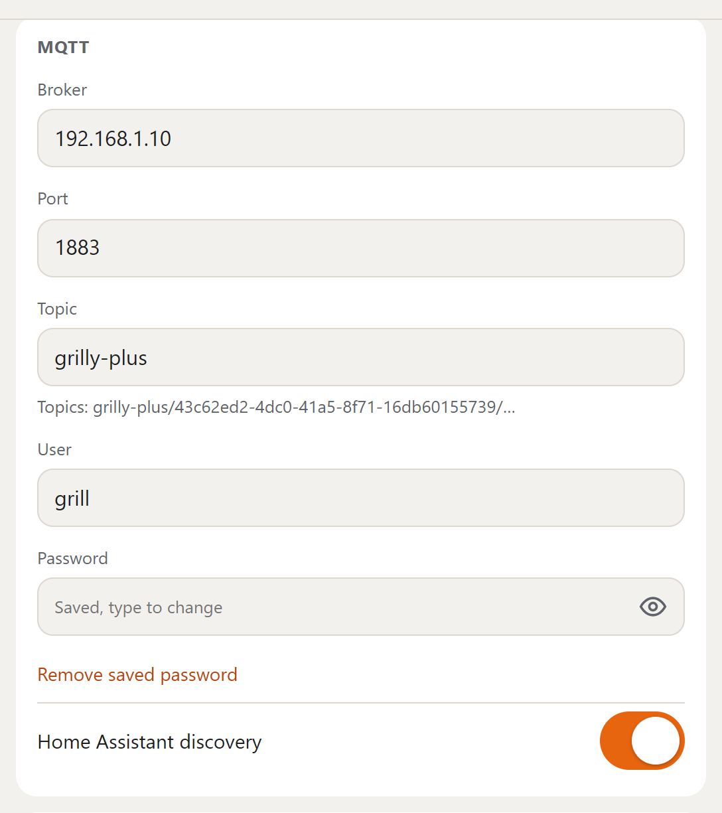

# MQTT

Grilly+ also supports sending and receiving data via a mqtt broker.

Set it up in the web app under **Settings**, card **MQTT**: **Broker**, **Port**, **Topic** (the prefix, default **`grilly-plus`**), **User**, **Password** and the **Home Assistant discovery** switch. Every field saves as soon as you leave it.

The data being sent and received is in the json format. This is the same data that is sent and received by the rest api. For a in depth spec you can reference the [openapi](./openapi.yaml) file.

## Topics

The following topics are provided:

The default prefix is `grilly-plus` and the uuid is in the format of a UUIDv4 generated on first boot.

- Publishing
    - `<prefix>/<uuid>/grill`
    - `<prefix>/<uuid>/probes`
    - `<prefix>/<uuid>/settings`
    - `<prefix>/<uuid>/error`
    - `<prefix>/<uuid>/status`
    - `homeassistant/<component>/grilly_plus_<uuid>/<entity>/config` (Home Assistant discovery)
- Subscribing
    - `<prefix>/<uuid>/config/probes`
    - `<prefix>/<uuid>/config/settings`
    - `<prefix>/<uuid>/config/mute`
    - `<prefix>/<uuid>/config/clear_history`

A full example looks like `grilly-plus/43c62ed2-4dc0-41a5-8f71-16db60155739/grill`.

The `grill` topic is sent every second and includes an `alarm_sounding` field that is `true` while a probe alarm is actively beeping, and each entry in its `probes` array has its own `alarm` field that is `true` for the probe(s) causing the sounding alarm. Each probe in the `grill` and `probes` topics also has `eta_seconds`, the number of seconds until the target temperature at the current rate, or `-1` when unknown, `stalled`, `true` while a probe in target mode is in the stall (flat for 20 minutes between 60 and 80 °C), `type_icon`, the food type shown as an icon (`""`, `beef`, `lamb`, `pork`, `poultry`, `fish`, `sausage`, `vegetables`, `pit` or `other`, also settable through `/config/probes`), `rest_minutes`, the rest timer that starts when a probe in target mode reaches its target (0 is off, 0 to 180, also settable through `/config/probes`), and `lid_open`, `true` while a probe in range mode waits after a sharp drop before it calls the temperature too low. The `grill` topic also has `update_available`, the version of a newer GitHub release or an empty string, `timers`, the running and finished timers (`id`, `name`, `remaining_s`, `length_s`, `done` and `probe`, which is 0 or the probe of a rest timer), and `alarm_timers`, a bitmask of the timers that caused the sounding alarm. A mute also clears the timers that ran out. Timers are started and stopped through the API. Updates can't be installed over MQTT, use the web interface or the API. The `probes` and `settings` topics are published when the probe or grill settings change, and again every time the grill (re)connects to the broker.

Sending any non-empty payload (the content is ignored, Home Assistant sends `mute`) to `/config/mute` mutes a sounding alarm, the same as pressing the grill's button. Empty messages are ignored on every `/config` topic, because the grill uses them to clear retained messages (see below).

Sending `{"probe_id": N}` to `/config/clear_history` clears the temperature history of that probe (the graph and time-to-target start over).

When publishing to the `probes` and `settings` topic the messages will have their **retain** flag set to true. That way the latest known settings are always available for whoever subscribes.

Messages on `/config/probes` and `/config/settings` may be partial: only the keys you send are changed, missing keys keep their current value. For probes, `probe_id` (1-8) is required in every entry. If any value has the wrong type or is out of range, the whole message is rejected and nothing is changed. The reason is published (not retained) to `<prefix>/<uuid>/error` as `{"topic": "<config topic>", "error": "<reason>"}`. A bad `/config/clear_history` payload publishes the same way. Messages larger than 4096 bytes are rejected with `Message is too large`.

Passwords and the Telegram bot token are never published on the `settings` topic, only whether they're set (`mqtt_password_set`, `telegram_token_set` and so on).

`admin_password` can't be changed over MQTT: a `/config/settings` message that contains it is rejected as a whole. Resetting a forgotten admin password with the code on the grill's screen is only possible through the web app or the local API.

For the topics that Grilly+ is subscribed to (`/config/probes`, `/config/settings`, `/config/mute` and `/config/clear_history`), Grilly+ takes into account that there might be a message with the retain flag set. So after reading the message Grilly+ will also publish a new message with retain set to true and a 0 byte payload to clear the existing message.

`<prefix>/<uuid>/status` is `online` (retained) while the grill is connected. The grill sets `offline` as its last will, so the broker publishes that when the grill drops off.

## Home Assistant discovery

With `mqtt_ha_discovery` on (the default), the grill publishes a retained [discovery](https://www.home-assistant.io/integrations/mqtt/#mqtt-discovery) config for each of its entities to `homeassistant/<component>/grilly_plus_<uuid>/<entity>/config` every time it connects, and again when the grill name, the temperature unit or the switch changes. Home Assistant then shows one device, named after the grill, with:

- `battery`, `battery_charging`, `wifi_signal`, `alarm` and `update_available`
- `next_timer`, a timestamp of when the first running timer ends, unknown without one
- `probe1_temperature` to `probe8_temperature`, and for every probe `_target`, `_time_to_target` (seconds), `_stalled` and `_alarm`
- the `mute` button, which sends `mute` to `/config/mute`

All entities except the mute button (which only sends) read the `grill` topic. They are unavailable while `status` is `offline`, and a probe's entities also while that probe isn't connected. Turning `mqtt_ha_discovery` off publishes empty retained configs, which removes the device from Home Assistant.

## Testing your MQTT connection

Grilly+ publishes and subscribes with QoS 0, which is fire and forget: it sends to whatever broker you have provided and doesn't get a confirmation that a message arrived. Whether the grill is connected at all shows on the retained `status` topic.

This makes mqtt sometimes a bit difficult to debug. An easy way to test your mqtt settings is by using one of the free mqtt brokers and a test client.

A free to use tool is the [mqtt.cool testclient](https://testclient-cloud.mqtt.cool).

Click on connect and you will see a dashboard waiting to be configured:

In this example we are connected to the mqtt.cool broker: `broker.mqtt.cool`.

First configure your Grilly+. Open the web app, go to **Settings** and find the **MQTT** card. Fill in `broker.mqtt.cool` as **Broker**; it saves as soon as you leave the field.

The hint below **Topic** shows where your grill publishes: `Topics: <prefix>/<uuid>/…`. Subscribe to that path with `#` at the end, for example `grilly-plus/43c62ed2-4dc0-41a5-8f71-16db60155739/#`. In MQTT `#` is a wildcard, so this gives you every topic of the grill: `grill`, `probes`, `settings`, `status`, `error` and the `config` topics.

Now go back to the mqtt.cool dashboard, fill in the wildcard topic and click subscribe. You will now start to see mqtt messages coming in:

